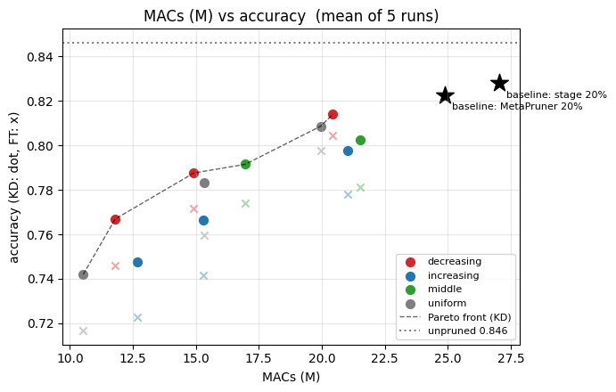
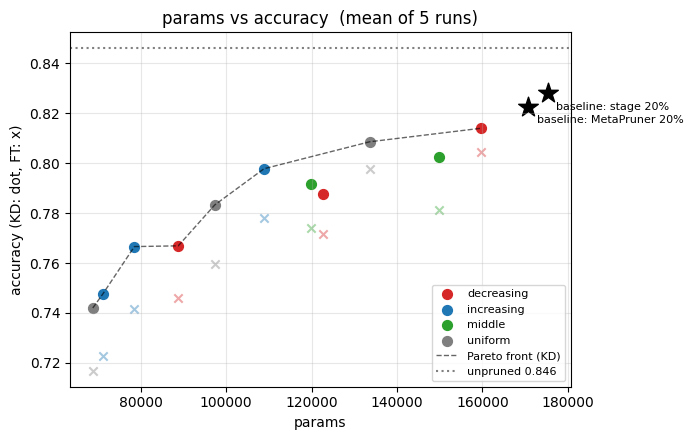

# ResNet-20 스테이지별 구조적 프루닝 + 지식증류

[English](README.md) | **한국어**



## TL;DR

- 앞 스테이지(A)를 많이 자른 조합은 전 층 균등 20% 대비 **MACs 18% 적게, 정확도 약 0.9%p 감소** (KD, 5 run 평균 acc_kd 0.814 vs 0.823)
- 같은 연산량일 때, **앞(A)을 더 많이 자르면 정확도에 유리하고, 뒤(C)를 더 많이 자르면 params 감소에 유리하다** (정확도와 크기의 trade-off)
- **KD 는 65번의 비교 중 64번 FT(fine-tuning) 보다 높았고**, 많이 자를수록 FT와 비교한 KD의 상승 폭이 커졌다 (+0.9 → +2.5%p)

## 질문

1. ResNet-20 의 세 스테이지(A·B·C) 중 어디가 프루닝에 민감한가?
2. 스테이지마다 다른 비율로 자르면, 전 층 균등 20% 프루닝보다 **작으면서** 비슷한 정확도를 낼 수 있는가?
3. 같은 연산량이라면 어느 스테이지를 많이 자르는 것이 유리한가?

## 실험 설정

| 항목 | 값 |
|---|---|
| 모델 | ResNet-20 (CIFAR-10 사전학습, FP32 정확도 0.846, 41.2M MACs, 272,474 params) |
| 데이터 | CIFAR-10 부분집합 — 학습 10,000장, 평가 2,000장 |
| 프루닝 | 구조적(채널 단위), L1-norm 중요도, torch-pruning 1.6.0 `DependencyGraph` |
| Fine-tuning | SGD (lr 1e-2, momentum 0.9, weight decay 5e-4), cosine 스케줄, batch 128, 3 epoch |
| 증강 | 좌우 뒤집기, 4px 패딩 후 랜덤 자르기 |
| KD | teacher = 원본 ResNet-20, T(온도) = 4, α(CE 가중치) = 0.5, 나머지는 FT 와 동일 |
| 반복 | 5 run, run 마다 seed 변경 (run k → seed k−1) |
| 환경 | Google Colab, NVIDIA T4 (조합당 FT 약 5초, KD 약 7초) |

KD 손실: `α·CE + (1−α)·T²·KL(teacher ‖ student)` — 정답 맞히기(CE)와 teacher 의 확률 분포 따라가기(KL)를 섞습니다.

## 방법

### ResNet-20 의 구조와 "묶음"

ResNet 은 shortcut 연결 때문에 한 스테이지 안의 블록 출력 채널이 하나로 묶여 있어, 따로 자를 수 없습니다.

| 스테이지 | 범위 | 채널 | 해상도 | conv 하나의 params | conv 하나의 MACs |
|---|---|---|---|---|---|
| A | stem · layer1 | 16 | 32×32 | 16×16×3×3 = 2,304 | 2,304 × 32×32 ≈ 2.36M |
| B | layer2 | 32 | 16×16 | 32×32×3×3 = 9,216 | 9,216 × 16×16 ≈ 2.36M |
| C | layer3 (→ fc) | 64 | 8×8 | 64×64×3×3 = 36,864 | 36,864 × 8×8 ≈ 2.36M |

conv 의 params = 입력 채널 × 출력 채널 × 3×3 이고, MACs = params × 출력 해상도(가로×세로) 입니다.
채널이 2배가 될 때 해상도는 1/4 이 되므로, **conv 하나의 MACs 는 스테이지마다 거의 같고 params 는 4배씩 커집니다.**
이 구조가 결과 해석의 핵심입니다.

### Part 1 — 스테이지 민감도 (회복 학습 없음)

스테이지마다 shortcut 경로만 20% 잘라, 단독/누적으로 정확도 하락을 비교합니다.
비율 0.5 에서는 경로 2개만 잘라도 정확도가 0.10(10 클래스 무작위 수준)에 닿아 차이를 볼 수 없어서 0.2 를 사용했습니다.

### Part 2 — 스테이지별 비율 + 회복 학습

- 스테이지마다 비율 하나 `(rA, rB, rC)` 를 정하고, shortcut 경로와 블록 내부(conv1 출력)를 같은 비율로 자릅니다.
- 기준선: torch-pruning `MetaPruner` 로 전 층 균등 20% (fc 제외).
- 조합마다: 프루닝 → (그대로 / FT / KD) 정확도 측정.

## 공정한 비교를 위한 장치

- **같은 범위**: 경로만 자르지 않고 블록 내부까지 잘라, 전 층을 자르는 기준선과 대상 범위를 맞춤
- **더 작은 모델만 후보**: 기준선보다 MACs **와** params 가 **모두** 작은 조합만 비교
- **같은 조건**: 모든 조합에 같은 데이터 · epoch · 학습률 · 평가 세트 · seed
- **기준선도 같은 절차**: MetaPruner 20% 와 스테이지 균등 20% 를 같은 FT/KD 로 학습
- **반복 실행**: run 을 여러 번 돌려 평균과 표준편차 보고

## 실험 설계: 125 → 83 → 11

1. 0.1~0.5 다섯 단계 × 3 스테이지 = **125** 조합
2. 기준선(24.89M MACs, 170,772 params)보다 둘 다 작은 조합 = **83**
3. 대표 **11** 개: MACs 가 비슷한 묶음(tier) 안에서 자르는 위치(shape)만 바꿈

| tier | uniform (균등) | increasing (C 를 많이) | decreasing (A 를 많이) | middle (B 를 많이) |
|---|---|---|---|---|
| ~20M | (0.3, 0.3, 0.3) | (0.2, 0.3, 0.4) | (0.4, 0.3, 0.2) | (0.2, 0.5, 0.2) |
| ~15M | (0.4, 0.4, 0.4) | (0.3, 0.4, 0.5) | (0.5, 0.4, 0.3) | (0.3, 0.5, 0.3) |
| ~11M | (0.5, 0.5, 0.5) | (0.4, 0.5, 0.5) | (0.5, 0.5, 0.4) | — |

## 결과

### Part 1 — 민감도 (비율 0.2, 회복 학습 없음)

| 자른 경로 | 정확도 | 비고 |
|---|---|---|
| 없음 | 0.846 | 원본 |
| A | 0.7955 | |
| A + B | 0.6770 | |
| A + B + C | 0.4795 | |
| B 만 | 0.7340 | |
| C 만 | 0.7665 | |

### Part 2 — 회복 학습 후 (5 run 평균 ± 표준편차)

| tier | shape | MACs (M) | params | acc_ft | acc_kd | kd_gain (%p) |
|---|---|---|---|---|---|---|
| 기준선 | MetaPruner 20% | 24.89 | 170,772 | 0.814 ± 0.004 | 0.823 ± 0.003 | +0.88 |
| 기준선 | stage 20% | 27.04 | 175,362 | 0.820 ± 0.004 | 0.828 ± 0.004 | +0.85 |
| ~20M | uniform | 19.95 | 133,608 | 0.798 ± 0.002 | 0.809 ± 0.003 | +1.09 |
| ~20M | increasing | 21.02 | 108,869 | 0.778 ± 0.004 | 0.798 ± 0.004 | +1.99 |
| ~20M | decreasing | 20.44 | 159,597 | 0.805 ± 0.003 | **0.814** ± 0.003 | +0.95 |
| ~20M | middle | 21.51 | 149,922 | 0.781 ± 0.003 | 0.802 ± 0.004 | +2.12 |
| ~15M | uniform | 15.33 | 97,343 | 0.760 ± 0.004 | 0.783 ± 0.006 | +2.36 |
| ~15M | increasing | 15.30 | 78,524 | 0.742 ± 0.003 | 0.767 ± 0.004 | +2.50 |
| ~15M | decreasing | 14.92 | 122,580 | 0.772 ± 0.006 | 0.788 ± 0.002 | +1.60 |
| ~15M | middle | 16.96 | 119,904 | 0.774 ± 0.003 | **0.792** ± 0.004 | +1.76 |
| ~11M | uniform | 10.53 | 68,786 | 0.717 ± 0.003 | 0.742 ± 0.005 | +2.51 |
| ~11M | increasing | 12.68 | 71,132 | 0.723 ± 0.001 | 0.748 ± 0.005 | +2.47 |
| ~11M | decreasing | 11.80 | 88,790 | 0.746 ± 0.007 | **0.767** ± 0.006 | +2.08 |

점선은 KD 기준 Pareto front(같거나 적은 비용에서 더 정확한 대안이 없는 점), × 는 같은 조합의 FT 결과입니다.




## 인사이트

1. **민감도 순위는 자르는 비율에 따라 뒤집힌다.** (Part 1, 회복 학습 없음)
   - 비율 0.2 이하에서는 A 가 가장 덜 민감 (0.2: A 0.796 > C 0.767 > B 0.734)
   - 0.25 이상에서는 A 가 가장 민감 (0.25: A 0.586 < B 0.674 < C 0.722)
   - A 는 3채널 → 4채널을 자를 때 0.796 → 0.586 으로 **채널 하나에 21%p** 떨어지는 절벽이 있음
   - → 한 가지 비율만 보고 "어디가 민감하다" 고 결론 내리면 안 된다

2. **프루닝 직후 정확도로는 회복 후 순위를 예측할 수 없다.**
   - ~20M decreasing 은 프루닝 직후 0.101 (사실상 무작위)로 tier 에서 가장 낮았지만, KD 후 0.814 로 가장 높음
   - → 후보를 고를 때는 회복 학습 후 정확도로 비교해야 한다

3. **같은 양의 MACs 를 감소시킬 때, 앞(A)을 자르는 것이 정확도에 유리하고, params 를 줄이려면 뒤(C)를 자르는 것이 유리하다.**
   - 각 스테이지마다 MACs 는 비슷하지만 params 는 C 에 몰려 있음 (방법 섹션의 표 참고)
   - 그래서 A 를 자르면 MACs 는 감소하면서 params(용량)는 조금만 감소하고, C 를 자르면 params 가 크게 감소함
   - decreasing(A 를 많이)은 ~20M 에서 5 run 중 4번, ~11M 에서 5번 모두 tier 내 KD 정확도 1위
   - ~15M 에서는 middle 이 1위(0.792)였지만 MACs 가 2M 더 많고, decreasing(0.788)이 2위
   - increasing(C 를 많이)은 ~20M · ~15M 에서 정확도 최하위지만 params 는 최소 (~15M: 78,524개, 원본 대비 −71%)
   - MACs 기준 Pareto front: ~11M uniform → ~11M decreasing → ~15M decreasing → ~15M middle → ~20M uniform → ~20M decreasing

4. **KD 는 거의 항상 FT 보다 높았다.**
   - 5 run × 13 조합 = 65번 중 **64번** KD > FT (유일한 예외: run 3 의 stage 20%, −0.45%p)
   - 개별 차이는 작아도 방향이 일관되므로 "이 설정에서 KD 가 낫다" 는 신뢰할 만함

5. **많이 자를수록 KD 이득(%p)은 커지지만, 남은 차이를 메우는 비율은 비슷하다.**
   - kd_gain: 기준선 +0.9%p → ~11M +2.1~2.5%p
   - 메운 비율 = kd_gain ÷ (원본 − FT): 대부분 20~33%, ~11M 에서는 약 20% 로 오히려 낮음
   - → "많이 자를수록 KD 가 특별히 잘 듣는다" 기보다 "메울 차이가 커서 %p 가 커 보인다" 에 가까움

6. **KD 는 연산량을 아끼는 효과로도 볼 수 있다.**
   - KD 를 적용한 ~15M middle(16.96M, 0.792)이 FT 만 한 ~20M middle(21.51M, 0.781) · increasing(21.02M, 0.778)보다 높음
   - KD 를 적용한 ~11M decreasing(11.80M, 0.767)은 FT 만 한 ~15M decreasing(14.92M, 0.772)에 근접

7. **기준선과의 비교: 연산량은 줄었지만 정확도는 일관되게 조금 낮다.**
   - ~20M decreasing vs MetaPruner 20%: MACs −18%, params −7%, KD 정확도 −0.87%p
   - run 별 차이: −0.55, −0.30, −1.05, −1.65, −0.80%p → **5번 모두 낮음**
   - → "같은 정확도" 가 아니라 "정확도 약 0.9%p 를 내주고 MACs 18% 를 줄였다" 가 정확한 표현

## 한계

- **평가 세트가 2,000장**: 1장 = 0.05%p, 정확도 0.8 부근 표준오차 약 ±0.9%p. run 반복은 학습 무작위성만 줄이고 이 오차는 줄이지 못함
- **짧은 학습**: 학습 10,000장, 3 epoch. 더 길게 학습하면 FT 와 KD 의 차이가 줄어들 수 있음
- **MACs ≠ 실제 속도**: 지연시간은 측정하지 않음. 남는 채널이 8의 배수가 아니면(예: 13, 51) 하드웨어가 채널을 묶음 단위로 채워 계산해, MACs 감소만큼 빨라지지 않을 수 있음
- **기준선 크기 차이**: stage 20% 기준선은 반올림 때문에 MetaPruner 20% 보다 MACs 가 큼(27.04M vs 24.89M)이라 두 기준선의 정확도를 직접 비교하기 어려움
- **반올림**: 채널 수가 정수라 실제 자르는 비율이 명목 비율과 다름 (예: A 16채널 × 0.4 → 6채널 = 37.5%)
- **GPU 비결정성**: 같은 seed 에서도 cuDNN 연산 순서 차이로 결과가 조금씩 달라질 수 있음
- **CIFAR-10 과 ResNet-20 하나**에서의 결과

## 후속 실험

- epoch 를 늘렸을 때 KD 의 이점이 유지되는가
- 남는 채널을 8의 배수로 맞춘 조합 vs 비정렬 조합 — 정확도와 실제 지연시간 비교
  (16채널인 A 는 0% 또는 50% 만 가능해, 작은 모델에서는 세밀한 비율과 하드웨어 정렬이 충돌함)
- 실제 기기(NPU 등)에서 지연시간 측정
- 프루닝 + INT8 양자화: 자르는 위치(shape)에 따라 양자화 내성이 다른가
- 더 공격적인 비율(0.7~0.8)에서 KD 효과가 꺾이는가 (teacher–student 크기 차이)

## 재현 방법

```
resnet20-stage-pruning-kd/
├── notebooks/
│   ├── 01_stage_pruning_kd.ipynb      ← 기준 노트북 (영문)
│   └── 01_stage_pruning_kd.ko.ipynb   ← 한국어판 (코드 동일)
├── results/        run*.csv (원본), summary.csv (평균)
├── figures/        pareto_macs.png, pareto_params.png
└── requirements.txt
```

**Colab**: `notebooks/01_stage_pruning_kd.ipynb` 열기 → 런타임 유형 T4 GPU → 셀 1~3, 7~9 실행 →
셀 10 을 `RUN_ID = 1, 2, …` 로 반복 → 셀 11, 12.
결과는 구글 드라이브 `MyDrive/resnet20-stage-pruning-kd/` 에 저장됩니다.

**로컬**:

```
pip install -r requirements.txt
```

이후 `notebooks/` 에서 노트북 실행. GPU 가 없으면 CPU 로 실행됩니다 (훨씬 느림).

## 출처

- 데이터 부분집합과 사전학습 가중치: [imguru-mooc/AI_CAMPUS](https://github.com/imguru-mooc/AI_CAMPUS) (실행 시 내려받으며 이 레포에는 포함하지 않음)
- 프루닝 도구: [Torch-Pruning](https://github.com/VainF/Torch-Pruning)
