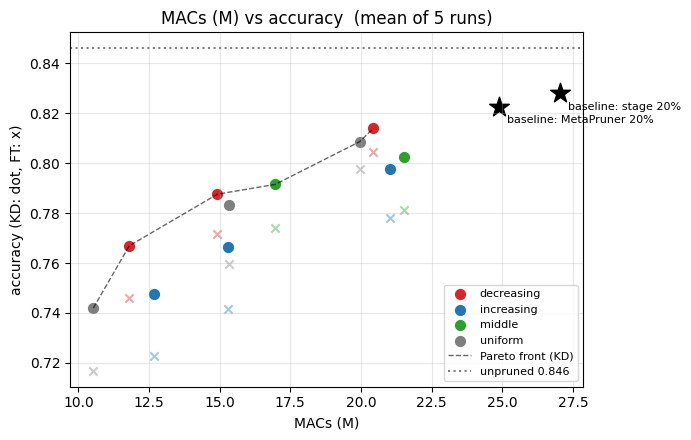
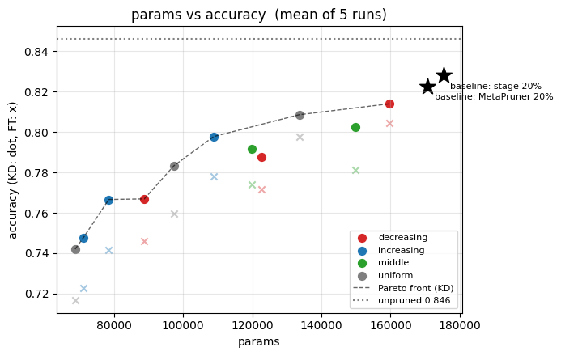

# ResNet-20 Stage-wise Structured Pruning + Knowledge Distillation

**English** | [한국어](README.ko.md)



## TL;DR

- Pruning the early stage (A) more aggressively gives **18% fewer MACs than uniform 20% pruning, at about −0.9%p accuracy** (KD, mean of 5 runs: acc_kd 0.814 vs 0.823)
- At the same compute, **pruning the early stage (A) more favors accuracy, while pruning the late stage (C) more favors parameter reduction** (an accuracy–size trade-off)
- **KD beat fine-tuning (FT) in 64 of 65 comparisons**, and its gain over FT grew with the pruning level (+0.9 → +2.5%p)

## Questions

1. Which of ResNet-20's three stages (A, B, C) is most sensitive to pruning?
2. With a different pruning ratio per stage, can we get a model that is **smaller** than uniform 20% pruning with similar accuracy?
3. At the same compute, which stage is it better to prune more?

## Setup

| Item | Value |
|---|---|
| Model | ResNet-20 (pretrained on CIFAR-10, FP32 accuracy 0.846, 41.2M MACs, 272,474 params) |
| Data | CIFAR-10 subsets — 10,000 train / 2,000 eval images |
| Pruning | Structured (channel-wise), L1-norm importance, torch-pruning 1.6.0 `DependencyGraph` |
| Fine-tuning | SGD (lr 1e-2, momentum 0.9, weight decay 5e-4), cosine schedule, batch 128, 3 epochs |
| Augmentation | Horizontal flip, 4-px padding + random crop |
| KD | Teacher = original ResNet-20, T (temperature) = 4, α (CE weight) = 0.5, otherwise identical to FT |
| Repetition | 5 runs, different seed per run (run k → seed k−1) |
| Environment | Google Colab, NVIDIA T4 (≈5 s FT, ≈7 s KD per combination) |

KD loss: `α·CE + (1−α)·T²·KL(teacher ‖ student)` — a mix of matching the ground truth (CE) and matching the teacher's probability distribution (KL).

## Method

### ResNet-20 structure and tied channels

Because of the shortcut connections, the output channels of all blocks in a stage are tied together and cannot be pruned independently.

| Stage | Scope | Channels | Resolution | Params | MACs |
|---|---|---|---|---|---|
| A | stem · layer1 | 16 | 32×32 | 14,480 (5.3%) | 14.84M (36.0%) |
| B | layer2 | 32 | 16×16 | 51,648 (19.0%) | 13.22M (32.1%) |
| C | layer3 | 64 | 8×8 | 205,696 (75.5%) | 13.16M (31.9%) |
| Head | pool · fc | — | — | 650 (0.2%) | 0.005M (0.0%) |
| **Total** | | | | **272,474** | **41.24M** |

For a single conv, params = input channels × output channels × 3×3, and MACs = params × output resolution (width × height).
Each time the channel count doubles, the resolution drops to 1/4, so **the MACs of each stage are almost the same, while the parameters grow about 4× per stage.**
This structure is key to interpreting the results.

### Part 1 — Stage sensitivity (no recovery training)

We prune only the shortcut path of each stage by 20% and compare the accuracy drop, both individually and cumulatively.
We use 0.2 because at 0.5, pruning just two paths already drops accuracy to 0.10 (random guessing over 10 classes), hiding any difference.

### Part 2 — Stage-wise ratios + recovery training

- Choose one ratio per stage `(rA, rB, rC)` and prune both the shortcut path and the block internals (conv1 outputs) at that ratio.
- Baseline: uniform 20% pruning of all layers with torch-pruning `MetaPruner` (fc excluded).
- For each combination: prune → measure accuracy (as-is / FT / KD).

## Fair comparison

- **Same scope**: block internals are pruned too, not just the paths, so the pruned scope matches the all-layer baseline
- **Only smaller models**: only combinations with **both** fewer MACs **and** fewer params than the baseline are compared
- **Same conditions**: identical data, epochs, learning rate, eval set and seed for every combination
- **Baselines get the same procedure**: MetaPruner 20% and stage-uniform 20% are trained with the same FT/KD
- **Repeated runs**: mean and standard deviation over multiple runs

## Design: 125 → 83 → 11

1. 5 levels (0.1–0.5) × 3 stages = **125** combinations
2. Combinations smaller than the baseline (24.89M MACs, 170,772 params) in both = **83**
3. **11** representatives: within each group of similar MACs (tier), only the pruning location (shape) changes

| Tier | uniform | increasing (more at C) | decreasing (more at A) | middle (more at B) |
|---|---|---|---|---|
| ~20M | (0.3, 0.3, 0.3) | (0.2, 0.3, 0.4) | (0.4, 0.3, 0.2) | (0.2, 0.5, 0.2) |
| ~15M | (0.4, 0.4, 0.4) | (0.3, 0.4, 0.5) | (0.5, 0.4, 0.3) | (0.3, 0.5, 0.3) |
| ~11M | (0.5, 0.5, 0.5) | (0.4, 0.5, 0.5) | (0.5, 0.5, 0.4) | — |

## Results

### Part 1 — Sensitivity (ratio 0.2, no recovery training)

| Pruned paths | Accuracy | Note |
|---|---|---|
| none | 0.846 | original |
| A | 0.7955 | |
| A + B | 0.6770 | |
| A + B + C | 0.4795 | |
| B only | 0.7340 | |
| C only | 0.7665 | |

### Part 2 — After recovery training (mean ± std over 5 runs)

| Tier | Shape | MACs (M) | Params | acc_ft | acc_kd | kd_gain (%p) |
|---|---|---|---|---|---|---|
| baseline | MetaPruner 20% | 24.89 | 170,772 | 0.814 ± 0.004 | 0.823 ± 0.003 | +0.88 |
| baseline | stage 20% | 27.04 | 175,362 | 0.820 ± 0.004 | 0.828 ± 0.004 | +0.85 |
| ~20M | uniform | 19.95 | 133,608 | 0.798 ± 0.002 | 0.809 ± 0.003 | +1.09 |
| ~20M | increasing | 21.02 | 108,869 | 0.778 ± 0.004 | 0.798 ± 0.004 | +1.99 |
| ~20M | decreasing | 20.44 | 159,597 | 0.805 ± 0.003 | **0.814** ± 0.003 | +0.95 |
| ~20M | middle | 21.51 | 149,922 | 0.781 ± 0.003 | 0.802 ± 0.004 | +2.12 |
| ~15M | uniform | 15.33 | 97,343 | 0.760 ± 0.004 | 0.783 ± 0.006 | +2.36 |
| ~15M | increasing | 15.30 | 78,524 | 0.742 ± 0.003 | 0.767 ± 0.004 | +2.50 |
| ~15M | decreasing | 14.92 | 122,580 | 0.772 ± 0.006 | 0.788 ± 0.002 | +1.60 |
| ~15M | middle | 16.96 | 119,904 | 0.774 ± 0.003 | **0.792** ± 0.004 | +1.76 |
| ~11M | uniform | 10.53 | 68,786 | 0.717 ± 0.003 | 0.742 ± 0.005 | +2.51 |
| ~11M | increasing | 12.68 | 71,132 | 0.723 ± 0.001 | 0.748 ± 0.005 | +2.47 |
| ~11M | decreasing | 11.80 | 88,790 | 0.746 ± 0.007 | **0.767** ± 0.006 | +2.08 |

The dashed line is the Pareto front for KD (points with no more accurate alternative at equal or lower cost); × marks the FT result of the same combination.




## Insights

1. **The sensitivity ranking flips with the pruning ratio.** (Part 1, no recovery training)
   - At ratios ≤ 0.2, A is the least sensitive (0.2: A 0.796 > C 0.767 > B 0.734)
   - At ratios ≥ 0.25, A is the most sensitive (0.25: A 0.586 < B 0.674 < C 0.722)
   - A has a cliff: going from 3 to 4 pruned channels drops accuracy 0.796 → 0.586, **21%p for a single channel**
   - → Don't conclude "where is sensitive" from a single ratio

2. **Accuracy right after pruning does not predict the ranking after recovery.**
   - ~20M decreasing scored 0.101 right after pruning (essentially random), the lowest in its tier, yet reached 0.814 after KD, the highest
   - → Compare candidates by their accuracy after recovery training

3. **When reducing the same amount of MACs, pruning early (A) is better for accuracy; to reduce params, pruning late (C) is better.**
   - MACs are similar across stages, but parameters are concentrated in C (see the table in Method)
   - So pruning A reduces MACs while reducing params (capacity) only slightly, whereas pruning C reduces params substantially
   - decreasing (more at A) ranked first in KD accuracy within its tier in 4 of 5 runs at ~20M and in all 5 runs at ~11M
   - At ~15M, middle ranked first (0.792) but with 2M more MACs; decreasing (0.788) was second
   - increasing (more at C) had the lowest accuracy at ~20M and ~15M but the fewest params (~15M: 78,524, −71% vs. the original)
   - Pareto front by MACs: ~11M uniform → ~11M decreasing → ~15M decreasing → ~15M middle → ~20M uniform → ~20M decreasing

4. **KD almost always beat FT.**
   - KD > FT in **64** of 65 comparisons (5 runs × 13 combinations); the only exception was stage 20% in run 3 (−0.45%p)
   - Individual differences are small, but the direction is consistent, so "KD is better in this setting" is reliable

5. **KD's gain in %p grows with pruning, but the share of the remaining gap it closes stays similar.**
   - kd_gain: +0.9%p at the baseline → +2.1–2.5%p at ~11M
   - Gap closed = kd_gain ÷ (original − FT): mostly 20–33%, and only about 20% at ~11M
   - → Closer to "there is more gap to close, so the %p looks bigger" than "KD works especially well under heavy pruning"

6. **KD can also be seen as saving compute.**
   - ~15M middle with KD (16.96M, 0.792) beat ~20M middle (21.51M, 0.781) and increasing (21.02M, 0.778) with FT only
   - ~11M decreasing with KD (11.80M, 0.767) came close to ~15M decreasing with FT only (14.92M, 0.772)

7. **Against the baseline: less compute, but consistently slightly lower accuracy.**
   - ~20M decreasing vs. MetaPruner 20%: MACs −18%, params −7%, KD accuracy −0.87%p
   - Per-run difference: −0.55, −0.30, −1.05, −1.65, −0.80%p → **lower in all 5 runs**
   - → The accurate statement is not "same accuracy" but "traded about 0.9%p accuracy for 18% fewer MACs"

## Limitations

- **Eval set of 2,000 images**: one image = 0.05%p; standard error near 0.8 accuracy ≈ ±0.9%p. Repeating runs reduces training randomness only, not this error
- **Short training**: 10,000 training images, 3 epochs. With longer training the FT–KD gap may shrink
- **MACs ≠ actual speed**: latency was not measured. If the remaining channel count is not a multiple of 8 (e.g. 13, 51), hardware may pad channels to its tile size, so speed may not improve as much as MACs suggest
- **Baseline size mismatch**: due to rounding, the stage 20% baseline has more MACs than MetaPruner 20% (27.04M vs 24.89M), so the two baselines' accuracies are not directly comparable
- **Rounding**: channel counts are integers, so the actual ratio differs from the nominal one (e.g. A: 16 channels × 0.4 → 6 channels = 37.5%)
- **GPU nondeterminism**: results can vary slightly even with the same seed because of cuDNN operation ordering
- Results are from **a single model (ResNet-20) on CIFAR-10**

## Future work

- Does KD's advantage persist with more epochs?
- Channel counts aligned to multiples of 8 vs. unaligned — accuracy and real latency
  (A has 16 channels, so only 0% or 50% is possible; on small models, fine-grained ratios conflict with hardware alignment)
- Latency measurement on real devices (e.g. NPUs)
- Pruning + INT8 quantization: does robustness to quantization depend on where we prune (shape)?
- Does KD's benefit drop at more aggressive ratios (0.7–0.8)? (teacher–student capacity gap)

## Reproduction

```
resnet20-stage-pruning-kd/
├── notebooks/
│   ├── 01_stage_pruning_kd.ipynb      ← source of truth (English)
│   └── 01_stage_pruning_kd.ko.ipynb   ← Korean version (identical code)
├── results/        run*.csv (raw), summary.csv (mean)
├── figures/        pareto_macs.png, pareto_params.png
└── requirements.txt
```

**Colab**: open `notebooks/01_stage_pruning_kd.ipynb` → set runtime type to T4 GPU → run cells 1–3 and 7–9 →
repeat cell 10 with `RUN_ID = 1, 2, …` → cells 11 and 12.
Results are saved to Google Drive under `MyDrive/resnet20-stage-pruning-kd/`.

**Local**:

```
pip install -r requirements.txt
```

Then run the notebook from `notebooks/`. Without a GPU it runs on CPU (much slower).

## Credits

- Data subsets and pretrained weights: [imguru-mooc/AI_CAMPUS](https://github.com/imguru-mooc/AI_CAMPUS) (downloaded at runtime, not included in this repo)
- Pruning library: [Torch-Pruning](https://github.com/VainF/Torch-Pruning)
